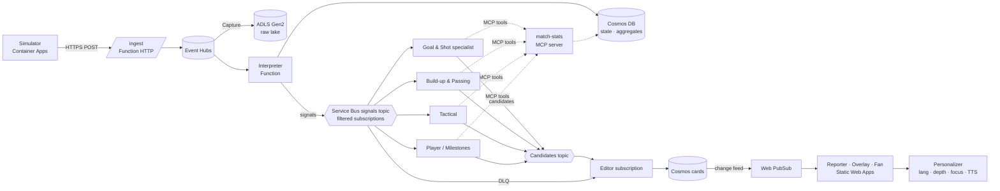

# Architecture

Event-driven pipeline. Stats are computed **deterministically** in code. LLM agents run only when a threshold-gated **signal** fires, and they write the *why*. The numbers always come from tools, never from the model.

## AWS → Azure mapping
| AWS (original idea) | Azure | Difference worth knowing |
|---|---|---|
| Data-generating agent | Simulator on **Container Apps** | Deterministic and seeded instead of LLM-driven (ADR-002) |
| API Gateway | **Functions HTTP trigger** | APIM is the true equivalent but overkill here (ADR-010) |
| Kinesis Data Streams | **Event Hubs** | Kafka-compatible; partitions + consumer groups like shards + consumers |
| Firehose → S3 | **Event Hubs Capture → ADLS Gen2** | Built-in, no code; Avro files |
| "S3 for NoSQL" | **Cosmos DB** (serverless) | S3 ≈ ADLS (lake). NoSQL serving is a separate store. |
| Lambda | **Azure Functions** | Same model; Event Hub trigger ≈ Kinesis trigger |
| SNS + filter policies | **Service Bus topics + SQL filters** | Adds dead-letter queues and sessions; Event Grid is the lighter alternative (ADR-004) |
| Agents (unspecified) | **Microsoft Agent Framework** + **Foundry** models | Foundry gives model hosting, tracing, evals |
| WebSocket push | **Web PubSub** | ≈ API Gateway WebSocket APIs |
| Static site | **Static Web Apps** | ≈ S3 + CloudFront / Amplify |
| Polly | **AI Speech** | Neural TTS in many languages |
| CloudFormation/CDK | **Bicep + azd** | `azd up` provisions and deploys |

## Agents
| Agent | Subscribes to | Produces |
|---|---|---|
| Goal & Shot | `goal`, `shot`, `penalty` | Chance quality, shot speed, goal timing context |
| Build-up & Passing | `pass_streak`, `pass_milestone`, `progression` | Pass difficulty, receptions inside the opponent's shape |
| Tactical | `pressure_shift`, `attack_side_shift`, `rhythm_change` | Control vs chaos, point-of-attack changes, fullback inversion |
| Player / Milestones | `speed_threshold`, `distance_threshold`, `record` | Player tagging, records |
| Editor | all candidates + DLQ | Ranked, deduped, rate-limited cards; HT/FT recap trigger |

**Candidate schema:** `{candidate_id, signal_id, match_id, headline, why_it_matters, metrics{}, evidence_event_ids[], entity_ids[], topic, self_salience, ttl_s, match_clock_s}`. The generic Container Apps runtime consumes one configured filtered subscription and publishes candidates for the Editor.

## Failure handling
- Each signal has a delivery timeout. After max retries it goes to the **DLQ**.
- The Editor watches the DLQ and emits a **templated deterministic card** ("Goal — Rivas, 67', 104 km/h"), so the feed never goes silent.
- Agent health (last heartbeat, error rate) is shown on the **Control room** page.
- Traces go to Application Insights / Foundry tracing.

## Editor budget (see ADR-008)
`salience = event_weight × rarity × recency_decay × relevance(focus)`. Critical events preempt. Otherwise at most 1 card per ~20–30 s, a visible queue of 6–8, a TTL of ~2–3 min, and dedupe by topic. All values live in `editor.yaml`.
