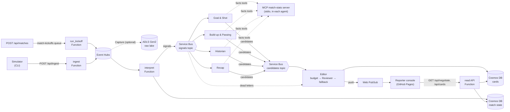

# Architecture

An event-driven pipeline. Code computes every statistic. Agents run only when a threshold-gated **signal** fires, and they write the words. Every number in a card comes from facts built in code, never from the model.

## Components

| Component | Code | Runs on |
|---|---|---|
| Simulator | `calacat_narrator/simulator.py` | Your machine (CLI), or the `run_kickoff` Function for judge-started matches |
| `ingest`, `interpret`, read API, kickoff | `function_app.py`, `ingest.py`, `interpreter.py`, `signals.py`, `kickoff.py` | Azure Functions (Flex Consumption) |
| Agents | `agent_worker.py`, `agent_runtime.py`, `history.py`, `recap.py`, `mcp_stats.py` | Container Apps, one app per Service Bus subscription, same image |
| Editor and Reviewer | `editor_worker.py`, `editor.py` | Container Apps, one replica |
| Reporter console | `web/` | GitHub Pages |
| Infrastructure | `infra/`, `azure.yaml` | Bicep, deployed with `azd up` |

## Agents

| Agent | Subscription and signal kinds | Facts tool | Writes |
|---|---|---|---|
| Goal & Shot | `goal-shot`: `goal`, `penalty`, `shot_volume` | `get_event_facts` | Who scored, the minute, the new score, the shot; penalties; shot counts |
| Build-up & Passing | `buildup-passing`: `pass_streak` (also routes `pass_milestone`, `progression`, which nothing raises yet) | `get_event_facts` | Passing runs |
| Historian | `historian`: `goal`, `pass_streak` | `get_history_facts` | The moment in historical context, from a fictional club archive |
| Recap | `recap`: `full_time` | `get_recap_facts` | The full-time summary from the final match state |
| Reviewer | Called by the Editor, not subscribed | The same facts, rebuilt from the card | Approve, revise or reject, plus the Spanish version |

Each agent gets one **forced** tool call with no arguments, so it can never write a caption without the facts. The worker answers that call through the MCP server (ADR-048), so the model never sees IDs or field names. The application, not the model, attaches the metrics, evidence IDs, team and player. The Editor is code, not an agent.

The `tactical` and `player-milestones` subscriptions exist in Service Bus, but no agent consumes them yet. The Editor watches their dead letters.

**Known gap:** the interpreter raises `red_card` signals, but no subscription's filter includes `red_card`, so a red card produces no card yet. Adding `red_card` to the `goal-shot` filter in `infra/modules/messaging.bicep` would route it, and the Editor already treats it as critical.

## Failure handling

- An agent that fails or times out abandons its message. Service Bus retries it, then moves it to the subscription's dead-letter queue.
- The Editor reads those dead letters and publishes a **template card** built from the same facts, in English and Spanish, so a goal is never missed. The Historian's subscription is the exception: the Goal & Shot dead letter already covers the goal.
- A Reviewer timeout, error or invalid output also publishes the template. A Reviewer **reject** drops a normal card, but a critical card (goal, penalty, red card, full time) publishes its template instead.
- Tracing (ADR-049) shows each card's path, from Event Hubs processing to the Editor, in Application Insights.

## Editor budget (ADR-008, ADR-028)

`salience = topic weight × rarity × recency decay × focus relevance`, from `data/editor.yaml`. The agent's own `self_salience` is never used as the score.

- **Critical topics** (`goal`, `penalty`, `red_card`, `full_time`) skip the queue and aren't deduplicated against each other, so every goal surfaces. A stable card ID suppresses retries.
- **Everything else** waits in a ranked queue of up to 8. At most one card goes out every 25 s, deduplicated by topic per match, with a TTL of 180 s. Normal fallback cards share this budget.
- Cards are written append-only to the `calacat/cards` Cosmos container, partitioned by `match_id`, with `id = card_id` and a per-item TTL. They are then pushed to the `match-{match_id}` Web PubSub group. The contracts are in [data-model.md](data-model.md).

## Azure equivalents of the original AWS sketch

| AWS | Azure | Note |
|---|---|---|
| API Gateway | Functions HTTP trigger | API Management would be the true equivalent, but it's more than this needs (ADR-010) |
| Kinesis Data Streams | Event Hubs | Partitioned by `match_id` |
| Firehose → S3 | Event Hubs Capture → ADLS Gen2 | Built in, no code; behind a flag (ADR-050) |
| SNS + filter policies | Service Bus topics + SQL filters | Adds dead-letter queues (ADR-004) |
| Lambda | Azure Functions | |
| DynamoDB | Cosmos DB (serverless) | |
| API Gateway WebSockets | Web PubSub | |
| S3 + CloudFront | GitHub Pages | Chosen for an open, free demo (ADR-043) |
| CloudFormation / CDK | Bicep + `azd` | |
