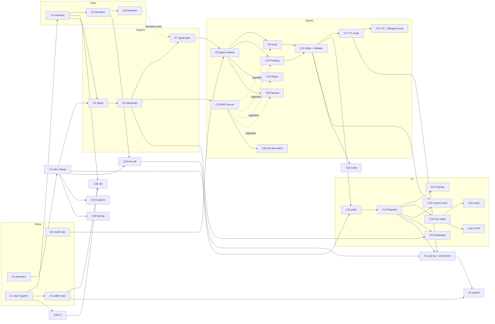

# Backlog

**Priority:** **P0** = the demo doesn't work without it · **P1** = earns rubric points, do if time allows · **P2** = only if everything else is done.
**Type:** **Azure** = done by hand in the portal/CLI (not in code) · **GitHub** = done by hand on github.com · **Code** = lives in the repo · **IaC** = code (Bicep) that creates Azure resources when you run `azd up`.

Deadline Oct 27 11:59 pm PT. Order inside each priority = build order.

## P0: must have
| ID | Issue | Type | Depends on | Notes |
|---|---|---|---|---|
| A1 | Register missing resource providers (EventHub, ServiceBus, App, Web, SignalRService, OperationalInsights) | Azure | — | Command in [progress.md](progress.md) |
| A2 | Give your account *Cognitive Services OpenAI User* on `calacat-narrator` | Azure | — | Lets us call the model without keys |
| A3 | Budget alert on the subscription | Azure | — | Portal → Cost Management → Budgets |
| C1 | Repo hygiene: commit docs, fix `Rules/`→`RULES/` case, MIT LICENSE, Python `.gitignore`, `.github/copilot-instructions.md` | Code | — | |
| C2 | Event schemas (pydantic) + fictional teams/players data | Code | C1 | Contract for everything else ([data-model.md](data-model.md)) |
| C3 | Simulator: seeded, `--speed`, events + 1 Hz positions, POSTs to `/ingest` (or writes to a file offline) | Code | C2 | Self-check: same seed → same match |
| C4 | Infra: `azure.yaml` + Bicep for Event Hubs, Storage, Cosmos (serverless), Service Bus topic + subscriptions + DLQ, Function App, Container Apps env + registry, Web PubSub, App Insights, Managed Identity role assignments; reference the existing Foundry resource | IaC | A1 | Region **East US** (ADR-020) |
| C5 | `/ingest` Function: validate schema → Event Hubs | Code | C2, C4 | Trust boundary (ADR-010) |
| C6 | Interpreter Function: match state + aggregates → Cosmos | Code | C5 | Self-check on a hand-built event list |
| C7 | Signal gate: `signals.yaml` (min sample, min minute, milestones, cooldown, hysteresis) → Service Bus | Code | C6 | Absolute thresholds first; baseline is C23 (ADR-013) |
| C8 | Agent runtime: Agent Framework + Foundry client (Entra ID), candidate/card schema, Service Bus consumer | Code | A2, C7 | Low reasoning effort (ADR-020) |
| C9 | Agent: Goal & Shot | Code | C8 | |
| C10 | Agent: Build-up & Passing | Code | C8 | |
| C11 | Editor: salience, rate limit, dedupe, TTL, critical preempt, **DLQ → templated fallback card**, writes cards to Cosmos | Code | C9, C10 | Multi-agent "recovery" proof (ADR-008) |
| C12 | Push cards to browsers: Cosmos change feed → Web PubSub | Code | C11 | |
| C13 | UI: Reporter feed + send-to-air, keyboard flow, ARIA live region | Code | C12 | Accessibility basics are not optional |
| C14 | UI: `/overlay` page (transparent background, timed card JSON) | Code | C13 | OBS browser-source ready |
| C15 | UI + Personalizer: Fan mode (EN/ES, Casual↔Analyst, favorite club, player focus), cached per (card, lang, depth) | Code | C13 | Required by Rules 4.1(i)(e) |
| C16 | "Kick off a match" endpoint + max 2 concurrent matches | Code | C3, C4 | Judges test asynchronously (ADR-016) |
| C17 | FT recap agent (summarize the match's top cards) | Code | C11 | Recaps are named in the brief; keep it small |
| D1 | Deploy with `azd up` + end-to-end smoke test (goal → card in under 5 s) | Azure + IaC | all above | |
| G1 | Make repo public + secret scanning + push protection | GitHub | C1 | Required for submission |
| S1 | Submission: README pitch + "Built with" + testing instructions, demo video under 2 min, submit on the hackathon site | Docs | D1 | Aim for Oct 27 noon PT |

## P1: should have
| ID | Issue | Type | Notes |
|---|---|---|---|
| C18 | MCP match-stats server; agents call tools through it | Code | Big for the "MCP integration" rubric item; swap in once C9/C10 work (ADR-009) |
| C19 | Agent: Player / milestones (speed/distance threshold tagging) | Code | "Player identification" is listed in the brief |
| C20 | Control room page: agent health + fallback count | Code | Makes failure recovery visible in the video |
| C21 | Heatmap + zone-control views (Vega-Lite) with text alternatives | Code | |
| C22 | Audio narration mode (TTS) | Code + Azure | You already have `gpt-4o-mini-tts` quota in Foundry; deploy it instead of creating a separate Speech resource |
| C23 | Baseline: simulate ~50 matches → expected-at-minute curves for the signal gate | Code | Adds deviation-based signals |
| C24 | Event Hubs Capture → ADLS raw lake | IaC | A Bicep flag; cheap "data lake" story |
| C25 | GitHub Actions CI: ruff + pytest + frontend build | Code | ADR-015 |
| C26 | OpenTelemetry tracing → App Insights / Foundry | Code | ADR-019 |
| C27 | HT recap + recap in both languages | Code | |
| A4 | Check Copilot plan; enable Agent Mode + Azure MCP Server in VS Code | GitHub | Rubric evidence (ADR-014) |

## P2: nice to have
| ID | Issue | Type |
|---|---|---|
| C28 | Tactical agent (pressure, control vs chaos, point-of-attack shifts) | Code |
| C29 | Ask-the-match agent (fan Q&A → text + chart) | Code |
| C30 | CD: `azd pipeline config` (deploy on merge, OIDC) | Code + Azure |
| C31 | Scenario director (LLM storylines in the simulator) | Code |
| C32 | Foundry evaluations: card groundedness | Code + Azure |
| C33 | Fabric Eventstream → Eventhouse | Azure + IaC |
| C34 | PT / FR languages | Code |
| C35 | Copilot coding-agent PRs from issues (needs Copilot Pro) | GitHub |

## How issues relate

**Critical path:** A1 → C4 → C5 → C6 → C7 → C8 → C9/C10 → C11 → C12 → C13 → D1 → S1. A delay anywhere on it delays the submission.
**Can run in parallel now:** C2 → C3 (offline, no Azure needed) while A1/A2 finish.
