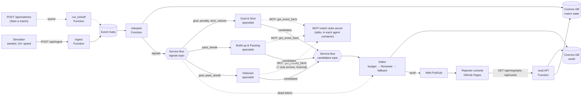

# Calacat Narrator


**Live football insight cards, written by a team of AI agents and checked before they go on air.**

A simulator plays a fictional football match. Azure turns its event stream into match state and fires a signal only when something is worth saying: a goal, a penalty, a run of shots, a long passing move. Specialist agents look up the facts with a tool and draft a short broadcast caption. Code picks which captions fit the on-air budget, a Reviewer agent approves, fixes or rejects each one and writes the Spanish version, and the card reaches the reporter's console within seconds. The reporter decides what goes on air.

The numbers never come from the model. Every number in a card comes from the event facts, and a validator rejects IDs, field names and raw seconds. If an agent is slow or fails, a templated card built from the same facts goes out instead, so the feed never goes quiet.

Entry for the Microsoft × Premier League "Inside the Game" hackathon, category **Best Multi-Agent System**. All teams, players and matches are fictional.

**Try it:** https://thiago-whatever.github.io/calacat-narrator/ (see [Testing instructions](#testing-instructions)).

## How it works



- **Ingest:** the simulator posts each event to an HTTP Function, which validates it against a strict schema and puts it on Event Hubs.
- **Interpret:** an Event Hubs–triggered Function updates the match state in Cosmos DB (score, clock, per-team counts) with ETag concurrency, and evaluates threshold rules. A rule that fires publishes a signal to a Service Bus topic, and filtered subscriptions route each kind to the right specialist.
- **Explain:** the specialists and the Reviewer run on Microsoft Agent Framework with a `gpt-5-mini` deployment in Microsoft Foundry. The Editor runs in code, between them (see [Agent roles](#agent-roles)).
- **Render:** the Editor stores each card in Cosmos DB and pushes it to the match's Web PubSub group. The console subscribes with a receive-only token and catches up from `GET /api/cards`.
- **Personalize:** English or Spanish (the Reviewer's translation), high contrast, larger text and reduced motion, all remembered in the browser.

More detail: [architecture](DOCS/architecture.md), [data model](DOCS/data-model.md), [decisions (ADRs)](DOCS/decisions.md).

## Agent roles

| Role | What it is | What it does |
| --- | --- | --- |
| **Specialists:** Goal & Shot, Build-up & Passing, Historian | Agent Framework agents, one Container App each, scaled on their Service Bus subscription | They get a signal kind but not the data. They call the **`get_event_facts`** tool, which returns plain words ("57'", "Bram Elsen scored for Northbridge Comets", "2–1"), and return structured JSON: a headline of up to 60 characters and a body of up to 180. The **Historian** calls **`get_history_facts`** instead: the same facts plus a fictional club and player archive, to put a goal or passing run in context ("a club record", "the club's all-time top scorer"); the record comparison is computed in code. A validator rejects IDs, field names, raw seconds and words like "signal" or "data". |
| **Editor** | Code, not a model | It scores each candidate as event weight × rarity × recency × focus, removes duplicates by topic and allows about one card every 20–30 s. Goals, penalties and red cards skip the queue. |
| **Reviewer** | A second agent with its own instructions | It reviews each card the Editor picks: **approve**, **revise** (wrong name, number or minute, voice, length) or **reject** (nothing newsworthy, so the slot stays free). It writes the Spanish version in the same call. Code then checks that every number in both languages appears in the facts and that each body gives the minute. |
| **Fallback** | Templates in code | If a signal dead-letters, an agent fails, or the Reviewer times out, errors or returns invalid output, the Editor publishes an English and Spanish card built from the same facts. A critical moment is never dropped. |

## Built with

- **Microsoft Foundry:** a `gpt-5-mini` model deployment, called with Entra ID (no keys).
- **Microsoft Agent Framework:** the specialists, the facts tool and the Reviewer.
- **Model Context Protocol:** the `calacat-match-stats` MCP server (`python -m calacat_narrator.mcp_stats`) serves the specialists' facts tools and `get_match_stats`; `.vscode/mcp.json` registers it for Copilot agent mode (ADR-048).
- **Azure Functions:** Flex Consumption, Python 3.12. Ingest, interpret and the read API.
- **Azure Event Hubs:** the match event stream.
- **Azure Service Bus:** topics with filtered subscriptions and dead-letter queues.
- **Azure Cosmos DB:** serverless; match state and cards.
- **Azure Container Apps:** the specialists and the Editor, with KEDA scaling on Service Bus.
- **Azure Web PubSub:** pushes cards to browsers.
- **Azure Container Registry** and **Application Insights**.
- **Bicep** and the **Azure Developer CLI** (`azd up`); managed identities throughout.
- **Python:** Pydantic contracts and pytest.
- **React 19, TypeScript, Vite and MUI:** the console; Vitest and oxlint.
- **GitHub Actions** for CI and **GitHub Pages** for the console.

## Testing instructions

No sign-in is needed. The console is a **receive-only demo build**, not a production broadcast tool. Going live happens only in your browser and resets on refresh (ADR-043).

### 1. The console in demo mode
1. Open https://thiago-whatever.github.io/calacat-narrator/.
2. Press **Play demo**. A scripted feed of insight cards plays on the right.
3. Click a card (or press J/K, then Enter) to place it on the program monitor. You can drag it, resize it or edit its text.
4. Press **Go live on TV 1**. A 5-second countdown runs, which you can cancel; then the card is on air. **Pull from air** (or Esc) removes it.
5. Switch between TV 1, TV 2 and Stream; each output holds its own on-air card.
6. Press **Open on-air output** for a tab that shows what viewers of one output see: only the card on air, with an ON AIR / OFF AIR tally. The **ⓘ** button in the header explains the demo, the live match and these steps.
7. Try **EN / ES**, and the **Accessibility** menu: high contrast, larger text, reduced motion and keyboard shortcuts.

### 2. A live match narrated by the agents
**On the hosted console: the Start live match button.** *TODO (C16, PR #68, merged): once deployed, a **Start live match** button appears on the Pages console. It starts a match on the server and switches the console to it. At most 2 matches run at once.* This is the only live path on the hosted demo: posting events to `/api/ingest` needs a Function key, which isn't published.

**In your own Azure subscription: run the simulator.** You need Python 3.12 and the Azure Developer CLI. Deploy everything with `azd up` (see [delivery](DOCS/delivery.md)), then read your own Function key and point the simulator at your own Function App:
```bash
git clone https://github.com/Thiago-whatever/calacat-narrator && cd calacat-narrator
pip install -e .
azd up
export INGEST_FUNCTION_KEY="$(az functionapp keys list -g <your-resource-group> -n <your-function-app> --query functionKeys.default -o tsv)"
python -m calacat_narrator.simulator --seed 48213 --speed 10 --output match.jsonl --ingest-url https://<your-function-app>.azurewebsites.net/api/ingest
```
The simulator reads the key from `INGEST_FUNCTION_KEY` only (never a flag), so keep it in your shell environment. While it runs, about 9 minutes at 10× speed, open your console with `?match=m-seed-48213`. The match ID is `m-seed-<seed>`. Use a seed nobody has used: a replayed seed's events are recognized as duplicates and produce no new cards. The first cards arrive within a minute of kick-off.

## Development

```bash
pip install -e ".[dev]"
ruff check . && pytest
cd web && npm ci && npm test && npm run lint && npm run build
```

CI ([ci.yml](.github/workflows/ci.yml), PR #70) runs the same checks on every pull request and push to `main`.

## License

[MIT](LICENSE). Fictional data only: no real clubs, players, leagues or trademarks.
